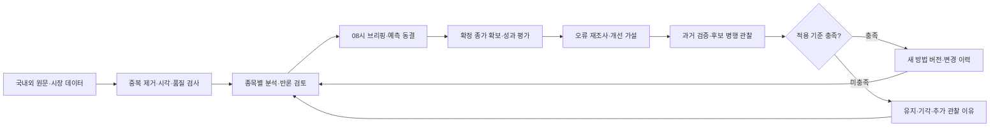

# Herdr 프로젝트 실행 계약

이 문서는 프로젝트 폴더에서 실행하는 주 모델과 협업 모델의 작업 기준이다. 사용자 입력을 읽고 허용된 완료 목표까지 실제 작업을 수행한다. 상위 지침과 기존 프로젝트 규칙을 우선하며, 빈칸은 승인이나 완료로 해석하지 않는다.

## 사용자 입력

필수 항목은 아이디어다. 경로는 실행 위치에서 확인하고 나머지 미입력 항목은 아래 기본값을 적용한다. 결과를 크게 바꾸는 미정만 질문한다.

```text
프로젝트 아이디어: 삼성전자·SK하이닉스의 국내외 투자 정보를 매일 한국 시간 08:00에 분석·예측하고, 장 마감 후 오류 재조사와 검증된 방법 개선을 시각적으로 공개하는 웹앱
누가 어떤 문제를 해결하는가: 개인 투자자가 흩어진 정보를 근거와 함께 이해하고 예측의 성적·한계·변화를 추적한다.
꼭 필요한 기능 또는 사용 예: 출처 기반 브리핑, 종목별 확률·시나리오 예측, 장 마감 복기, 개선 후보 검증, 방법 변경 이력, 전 과정 시각화
제외할 기능: 자동 주문·자금 운용, 무단 유료 자료 수집, 검증 없는 운영 방법 자동 변경
기존 코드 또는 참고자료: 현재 폴더의 HERDR-OPERATIONS.md와 이 문서의 제품 요구사항. 구현 코드는 아직 확인되지 않음
기술·기한·비용·데이터 제약: 한국어·출처 추적·시점 일치·불변 예측 기록 필수. 스택·기한·예산·데이터 계약·운영 환경은 구현 착수 시 확정
완료 목표: 이번 요청은 프로젝트 명세 작성. 향후 구현 착수 시 로컬 동작 검증과 인계를 기본 목표로 하며 실운영·성능 검증은 별도 증거로 판정
GitHub 대상 및 허용 행동: 미지정
배포 대상 및 허용 행동: 미지정
직접 지정할 모델 또는 effort: 없음
동시 협업 모델 수 상한: 2
AI 판단에 맡길 범위: 목표를 보존하는 가역적인 기술·구현 결정
사용자가 직접 결정할 범위: 핵심 목표 변경, 비용 증액, 공개 범위, 계정·권한, 운영 배포
```

아이디어가 여전히 대괄호 안내문이면 P1에서 아이디어를 요청한다. 예제 아이디어를 실제 사용자 요구로 채우지 않는다. 실제 프로젝트 경로가 불명확하면 경로부터 확인한다. 출력 문서는 한국어를 기본으로 한다.

## 삼성전자·SK하이닉스 투자 리서치 웹앱 — 제품 요구사항

작성일: 2026-11-07. 이 절은 향후 구현을 위한 제품 명세이며 현재 기능 구현·데이터 계약·예측 성능의 증거가 아니다. 이번 요청의 완료 범위는 이 문서 작성이다. 아래 공통 실행 계약의 개발·협업·배포 절차는 별도 구현 착수 요청부터 적용한다.

### 1. 목표와 성공의 정의

한국 개인 투자자가 매일 오전 8시에 삼성전자와 SK하이닉스에 영향을 주는 국내외 정보를 읽고, 오늘의 전망과 근거·반대 근거·불확실성을 이해하며, 장 마감 후 결과와 예측 방법의 개선 과정을 확인하는 한국어 웹앱을 만든다.

제품의 핵심은 `정보 수집 → 근거 분석 → 예측 동결 → 실제 결과 평가 → 오류 재조사 → 개선 후보 검증 → 방법 변경 이력 공개`의 연결이다. 수익이나 예측 정확도 향상을 보장하지 않는다. 시스템이 작동하는지와 예측이 유용한지는 별도로 평가한다.

- **사용자 경험:** 첫 화면에서 두 종목의 전망, 핵심 이유 세 가지, 주요 위험, 정보 기준 시각을 파악하고 출처와 과거 성적까지 탐색할 수 있다.
- **정직한 예측:** 모든 예측에 당시 사용한 정보·방법 버전·대상 기간을 연결한다. 틀린 예측, 판단 보류, 누락과 지연도 기록한다.
- **검증 가능한 학습:** 매 거래일 평가·재조사·개선 판단을 남긴다. 변경하지 않은 날도 이유를 남기며 검증된 변경만 운영 방법에 반영한다.
- **시각적 설명:** 결론·근거·실제 결과·개선 효과를 서로 연결된 차트와 짧은 한국어 설명으로 제공한다.

### 2. 초기 범위와 명시적 가정

| 항목 | 초기 기준 |
| --- | --- |
| 사용자 | 개인 사용자 1인, 비공개 사용을 기본값으로 설계 |
| 종목 | 삼성전자 보통주 005930, SK하이닉스 000660. 연결 전 공식 종목 마스터로 확인 |
| 시간 | 매일 08:00, `Asia/Seoul`. UTC 저장과 한국 시간 표시 병행 |
| 거래 기준 | KRX 정규시장 거래일·종가 기준. 다른 거래소·시간외 가격은 구분 표시하며 평가 가격과 혼합하지 않음 |
| 당일 예측 | 직전 거래일 종가 대비 해당 거래일 종가 수익률, 상승·중립·하락 확률, 예상 범위 |
| 보조 전망 | 5·20거래일 전망은 후속 단계. 각 만기 도래 후에만 확정 평가 |
| 휴장일 | 08:00 글로벌 브리핑과 다음 거래일 변수 안내. 새 당일 거래 예측·당일 성적은 생성하지 않음 |
| 장 마감 평가 | 거래 캘린더의 실제 장 종료와 확정 가격 확보 이후 수행. 데이터 공급 지연 시 평가 대기 |
| 비용·운영 | 유료 데이터·추가 모델 비용·배포 환경은 미정. 계약이나 결제는 별도 결정 |

08:00은 수집 시작 시간이 아니라 **브리핑 공개 목표 시각**이다. 초기 수집 마감은 07:40, 분석·검증은 07:40~07:55, 공개 준비는 07:55~08:00으로 설계하되 실제 지연 측정 후 조정한다. 이 마감 시각과 가정은 화면 및 설정 이력에 표시한다. 미국 서머타임·양국 휴장·조기 폐장·특별 거래시간을 캘린더로 처리한다.

초기 제외: 자동 주문, 투자금 운용, 신용·레버리지 추천, 무단 유료 기사 수집, 모든 국가·모든 매체의 완전 수집, 검증 없는 모델 자체 재학습·소스 코드 자동 배포. 실제 투자 성향·보유 자산에 맞춘 추천은 추가 요구와 데이터 없이 생성하지 않는다.

### 3. 정보 수집과 출처 신뢰성 — R01

“최고의 투자 정보”는 유명 매체 순위가 아니라 **원문 권위·종목 관련성·신선도·독립성·정정 이력·사용 가능 권리**로 판단한다. 한국·미국·기타 글로벌을 분리해 수집 범위를 보여주고, 미확보 지역·유료 자료·지연 자료를 명시한다.

| 범주 | 우선 정보와 연결 후보 | 두 종목에 대한 분석 질문 |
| --- | --- | --- |
| 기업·공시 | DART, 삼성전자·SK하이닉스 IR, 해외 기업 IR·SEC 공시 | 실적·가이던스·CAPEX·수율·고객 인증·제품 구성에 변화가 있는가? |
| 시장·수급 | 허가된 KRX 시세·투자자별 수급, 미국 반도체·주요 고객 주가, 환율 | 전일 가격 움직임과 수급이 새 정보의 영향을 이미 반영했는가? |
| 산업·공급망 | 메모리 가격 자료, HBM·DRAM·NAND 수급, 고객·경쟁사·장비사 발표 | 수요·공급·가격·납품 시점이 어느 회사에 더 중요한가? |
| 거시·정책 | 한국은행·미국 연준·공식 통계, 무역·수출 규제 발표 | 환율·금리·경기·정책이 수요와 가치 평가에 어떤 경로로 영향을 주는가? |
| 보도·리서치 | 이용 가능한 주요 통신사·경제지·증권사 리서치 | 원문 근거가 있는가? 기존 주장과 독립적인 정보인가? |

최초 연결 조사에 사용할 공식 진입점(2026-11-07 웹 확인): [KRX Open API](https://openapi.krx.co.kr/contents/OPP/MAIN/main/index.cmd), [Open DART 소개](https://opendart.fss.or.kr/intro/main.do), [Open DART 개발 가이드](https://opendart.fss.or.kr/guide/main.do?apiGrpCd=DS001), [SEC 공개 데이터](https://data.sec.gov/). 이 링크는 API 존재 확인이며 실시간성·당일 종가 공급 시간·요금·재배포 권리·계정 연결을 확인한 것이 아니다. 구현 전에 공급자별로 검증한다.

수집 규칙:

1. 기사·공시마다 제목, 원문 URL, 발행 기관, 언어, 발행·수정·최초 수집 시각, 대상 시장, 라이선스·저장 가능 범위, 내용 해시를 저장한다. 시간대를 알 수 없으면 당일 예측 근거에서 제외한다.
2. 원문을 보존할 권리가 있으면 스냅샷을 저장하고, 그렇지 않으면 허용된 메타데이터·요약·해시를 남겨 재현 한계를 표시한다. 유료·접근 불가 원문을 읽은 것처럼 요약하지 않는다.
3. 동일 공시를 인용한 기사와 번역·전재를 하나의 사건으로 묶는다. 원문 한 개의 재인용을 독립된 근거 여러 개로 세지 않는다.
4. 사실·회사 주장·애널리스트 전망·AI 해석·미확인 정보를 구분한다. 숫자는 통화·단위·기준 기간을 함께 저장한다.
5. 신뢰 점수와 예측 기여도는 구분한다. 권위 있는 출처라도 주가 방향을 맞힌다는 뜻은 아니다.
6. 한국·미국·기타 글로벌의 수집 성공률, 누락, 마지막 갱신 시각, 정정·상충 근거를 출처 상태 화면에서 보여준다.

### 4. 예측과 설명 계약 — R02

종목별 예측에는 다음 항목이 반드시 포함된다.

- 예측 ID, 대상 거래일·시장, 생성·공개·정보 마감 시각, 기준 가격과 출처, 평가 만기.
- 상승·중립·하락 확률(합계 100%), 예상 수익률과 가격 범위, 판단 보류 여부와 이유.
- 초기 분류 기준은 종가 수익률 `r > +0.5%` 상승, `r < -0.5%` 하락, 나머지 중립으로 한다. 이는 설계 기본값이며 최적값 주장이 아니다. 변경은 새 방법 버전에만 적용한다.
- 예상 범위는 명목 포함률(초기 80%)과 계산 방법을 표시한다. 실제 포함률을 검증하기 전에는 '보정 미검증'으로 표시한다.
- 핵심 근거 3개, 반대 근거, 주요 위험, 전망을 무효화할 조건, 다음 확인 이벤트.
- 주장별 근거 ID·원문 링크·해당 원문의 허용된 짧은 발췌 또는 요약. 인용이 실제 주장을 지지하는지 검증한다.
- 강세·기준·약세 시나리오의 조건과 예상 영향. 시나리오와 방향 분류는 다른 개념임을 설명한다.
- 데이터 스냅샷 ID, 특징값 버전, 프롬프트·모델·방법 버전, 확률 산출·보정 방식.

설명은 `관찰된 사실 → 예상 전달 경로 → 반대 증거 → 불확실성을 포함한 결론` 순서로 쓴다. 예: HBM 관련 발표가 확인되더라도 계약 규모·반영 시점·기존 기대를 알 수 없으면 즉각적인 이익 증가를 사실처럼 쓰지 않는다. 모델의 내부 사고과정 대신 확인 가능한 근거와 계산을 공개한다.

LLM은 문서 추출·비교·설명·오류 가설 생성에 사용하고, 수익률·점수·검정은 재현 가능한 코드로 계산한다. LLM이 임의로 말한 확률을 통계적으로 보정된 확률로 표현하지 않는다. 초기에 보정 자료가 부족하면 실험값으로 표시하거나 판단을 보류한다. 근거 없는 숫자와 가짜 인용이 있는 결과는 공개 검증에서 차단한다.

### 5. 매일 실행 흐름과 실패 처리 — R03



- 매일 정보 수집·브리핑을 실행하고 거래일에는 예측·평가·개선 판단을 추가한다. 거래일별 실행 키와 잠금으로 중복 실행을 막는다.
- 필수 가격·근거·시간 검증이 실패하면 08:00에 '분석 지연' 또는 '판단 보류' 상태와 원인을 공개한다. 전일 결과에는 전일 날짜를 명확히 표시한다.
- 공개된 예측과 입력 스냅샷은 불변이다. 마감 이후 뉴스는 별도 장중 업데이트로 표시하고 아침 예측의 사후 근거로 끼워 넣지 않는다.
- 08:00 이후 공개된 예측은 지연으로 표시하며 정시 예측 성적과 분리한다. 재시도는 원래 마감 이전 스냅샷만 사용한다.
- 종가 미확보·거래 정지·기업행사·휴장 예외는 '대기' 또는 사유가 있는 '평가 불가'로 기록하고 성공률 분모를 임의로 줄이지 않는다.
- 스케줄러는 웹 브라우저 종료와 무관하게 동작한다. 서버 중단 후에는 누락 작업을 식별하되 과거 예측을 당시 발표된 예측으로 생성하지 않는다.
- 작업별 타임아웃·제한된 재시도·오류 로그·호출량과 비용을 기록한다. 예산 초과 시 비필수 수집을 중단하고 성능 저하 상태를 알린다.

### 6. 장 마감 평가와 오류 재조사 — R04

당일 목표 수익률은 `r = (당일 확정 종가 / 직전 거래일 비교 가능한 종가 - 1) × 100`으로 계산한다. 기업행사로 기준 가격이 달라지면 사전에 정한 조정 정책과 공급자 버전을 적용한다. 조정 근거가 없으면 평가 불가로 남긴다. 가격 예측 성적과 배당 포함 투자 성적은 구분한다.

| 평가 항목 | 기록·시각화 |
| --- | --- |
| 방향 | 3분류 정답, 혼동행렬, 종목별·기간별 정확도 |
| 확률 | 3분류 Brier score, 보정 곡선, 표본 수. 초기 표본 부족 표시 |
| 수익률 | 예상값과 실제값의 MAE, 오차 분포 |
| 범위 | 예측 구간 포함 여부, 누적 포함률과 평균 구간 폭 |
| 제공 품질 | 정시 공개율, 판단 보류율, 평가 가능률, 데이터 결측률 |
| 비교 기준 | 과거 구간의 고정 분류 빈도 확률, 0% 수익률, 직전 방향 유지 기준선 |

모든 비교는 같은 종목·평가 기간·가용 시점·표본에 맞춘다. 최근 20·60·120거래일과 전체 기간을 제공하되 실제 확보한 기간·표본만 표시한다. 거래 전략을 추가할 경우 실행 가능한 진입 시점·비용·슬리피지·배당을 별도 정의하고, 전일 종가 대비 예측 수익률을 실제 매매 수익으로 표시하지 않는다.

예측 실패는 방향 오답, 구간 이탈, 사전 정의한 큰 오차로 구분한다. 맞은 날도 높은 확률의 과신·우연한 적중·틀린 근거 가능성을 점검한다. 재조사는 다음 구조를 따른다.

1. 아침에 알고 있던 정보와 장중·장후에 새로 알려진 정보를 시간축으로 분리한다.
2. 놓친 자료, 가중치 오류, 발표 시점 해석 오류, 데이터 오류, 시장 국면 변화, 예측 시점 이후 충격, 원인 미확인으로 분류한다. 복수 원인이 가능하다.
3. 각 원인 가설에 출처·발생 시각·반증 자료·설명력·불확실성을 붙인다. 사후 상관관계를 입증된 인과관계로 표현하지 않는다.
4. 당시 확보할 수 없었던 정보는 수집 실패와 구분한다. 수정된 과거 원문은 당시 버전과 구분한다.
5. 개선 제안, 예상 효과, 부작용, 검증 방법, 적용 여부를 기록한다. 원인을 모르면 '미확인'을 허용한다.

### 7. 매일 개선하는 방법과 승격 기준 — R05

매일 수정하는 대상은 **오류 지식·개선 후보·검증 기록**이다. 운영 예측 방법의 변경은 검증 결과에 따른다. 하루 오답에 맞춰 매일 가중치를 강제로 변경하면 과적합이 생길 수 있으므로 '유지'도 정상적인 개선 판단으로 기록한다.

개선 후보는 출처 추가·제외, 특징값, 가중치, 확률 보정, 분석 프롬프트, 모델, 분류 기준, 데이터 처리 변경 중 무엇을 바꾸는지 명확히 한다. 후보마다 변경 전후, 관련 오답 ID, 가설, 평가 지표, 성공·중단 기준을 **검증 전에** 고정한다.

- 시간순 학습·검증·최종 평가 분리를 사용한다. 매 시점 그때 알 수 있던 데이터만 사용하는 워크포워드 검증을 한다.
- 과거 뉴스의 당시 스냅샷이 없거나 모델 학습 데이터에 미래 사건이 들어갔을 가능성이 있으면 해당 백테스트의 한계를 표시한다. 실시간 전향 관찰 결과와 합산하지 않는다.
- 초기 승격 후보 기준: 최소 120거래일의 사용 가능한 시점 일치 자료, 그 안의 최종 미사용 평가 구간 20거래일 이상, 현행 방법과 후보의 전향 병행 관찰 20거래일 이상. 이는 검증 착수용 기본값이지 통계적 충분성 보장이 아니다.
- 주 지표는 동일 표본의 Brier score 개선으로 둔다. MAE, 구간 포함률·폭, 판단 보류율, 두 종목 각각의 성적, 지연·비용을 보호 지표로 확인한다.
- 날짜 단위 재표집 등 시계열·종목 상관을 고려해 개선 차이의 불확실성을 평가한다. 두 종목의 하루 결과를 독립 표본 두 개로 단순 계산하지 않는다.
- 반복 후보 탐색 횟수를 기록하고 평가용 자료를 재사용한 후보는 새 미사용 구간 또는 추가 전향 관찰로 검증한다. 기준을 충족하지 못하면 후보 유지·기각하며 현행 버전을 보존한다.
- 최초 실험 버전은 성능 미검증을 명시해 운영할 수 있다. 자동 승격은 충분한 데이터와 사전 정의된 보호 지표 허용치를 갖춘 뒤 활성화한다. 그 전에는 변경 후보를 검토 가능한 상태로 제공한다.
- 승격 시 적용 일시·대상·버전·근거·복구 버전을 기록한다. 다음 브리핑부터 적용하고 과거 예측을 다시 쓰지 않는다. 데이터 무결성 오류는 즉시 중지·복구하고 성능 저하는 사전 정의한 관찰 창으로 판단한다.

초기 승격 수치·관찰 창·보호 지표 허용치는 구현 준비 단계에서 데이터 가용성에 맞춰 확정하고 버전으로 관리한다. 값이 미정인 동안 자동 승격을 허용하지 않는다. AI의 소스 코드 수정과 운영 배포는 이 학습 루프에 포함하지 않는다.

### 8. 화면과 시각화 — R06

| 페이지 | 사용자가 이해할 내용 | 필수 시각화·상호작용 |
| --- | --- | --- |
| 오늘의 투자 브리핑 | 두 종목 전망, 이유, 위험, 오늘 주목할 사건 | 종목 비교 카드, 방향 확률 막대, 예상 범위, 중요 사건 시간축, 정보 마감·지연 표시 |
| 종목 상세 | 왜 이런 전망인지, 무엇이 바뀌면 틀리는지 | 가격·예측 범위 겹쳐 보기, 근거 연결도, 강세·기준·약세 조건 비교, 출처 열기 |
| 글로벌 정보 지도 | 한국·미국·기타 지역의 어떤 사건이 연결되는지 | 지역·주제 필터, 공급망 연결도, 사건 중복 묶음, 수집 범위와 결측 표시 |
| 장 마감 복기 | 아침 전망과 실제 결과의 차이 | 예측·실제 비교, 오차 달력, 당시/이후 정보 시간축, 실패 원인과 반증 카드 |
| 예측 방법 변경 이력 | 무엇을 왜 바꿨고 효과가 있었는지 | 버전 시간축, 변경 전후 비교, 관련 실패 연결, 검증 지표·표본·관찰 기간, 복구 이력 |
| 성과·신뢰도 | 장기간 기준선보다 나은지, 언제 약한지 | 누적·이동창 성적, 보정 곡선, 혼동행렬, 국면별 성적, 미평가·보류 수 |
| 데이터·운영 상태 | 오늘 결과가 최신이며 정상인지 | 단계별 실행 상태, 출처 신선도, 실패·지연·비용, 재실행 결과 |

공통 규칙:

- 화면 상단에 짧은 결론, 가운데 시각화, 펼치면 계산·원문·한계를 제공한다. 숫자·차트는 항상 설명 문장과 연결한다.
- 색만으로 상승·하락을 구분하지 않고 텍스트·아이콘·패턴을 병행한다. 범례·축·단위·기간·시간대·표본 수를 표시한다.
- 모든 차트에는 표 보기와 키보드 접근을 제공한다. 모바일에서 가로 잘림 없이 핵심 흐름을 이용할 수 있게 한다.
- 근거 기여도가 정량 계산되지 않았으면 임의의 퍼센트·정교한 워터폴을 만들지 않는다. 정성적 중요도로 표시한다.
- 예측 신뢰와 데이터 품질을 별도로 표시한다. 빈 데이터·오류·휴장 상태를 0이나 성공 상태처럼 그리지 않는다.
- 기간·종목 필터를 바꾸면 카드·차트·표의 분모와 범위가 함께 바뀐다. 차트 선택에서 원문·예측·복기·버전을 왕복 탐색할 수 있게 한다.

### 9. 데이터·시스템 요구사항 — R07

최소 저장 단위는 `SourceDocument → Evidence/MarketSnapshot → Forecast → Evaluation → ErrorAnalysis → MethodChange`다. `MethodVersion`, `Experiment`, `JobRun`, `TradingCalendar`를 별도로 두고 모든 관계를 ID로 연결한다.

- 예측은 입력 스냅샷·방법 버전과 연결하고, 평가는 예측 ID와 가격 출처를 참조한다. 평가 데이터 정정은 원본 기록을 유지한 새 개정으로 저장한다.
- 실험은 비교 버전·기간·데이터·미리 정한 기준·결과를 저장한다. 변경 이력은 적용·보류·기각·복구를 구분한다.
- 수집기, 정규화·품질 검사, 분석·예측, 평가·실험, 스케줄러, 조회 API, 웹 UI의 책임을 구분한다. 초기에는 단일 배포 앱과 작업 프로세스 정도로 단순하게 시작한다.
- 수치 산출은 테스트 가능한 함수로 구현하고, 모델 응답은 구조화 스키마로 검증한다. 실행 ID·입력 해시·오류·재시도와 관측 가능한 모델 식별자를 남긴다.
- 외부 문서는 데이터로만 처리하고 포함된 명령·링크 지시가 도구 실행·비밀 접근을 유발하지 않게 한다. UI 렌더링 시 외부 콘텐츠를 정화한다.
- API 키는 서버의 안전한 설정 경로에 두고 브라우저·로그에 노출하지 않는다. 원격 접근 시 인증을 적용한다.
- DB·방법 버전·허용된 원문 저장소를 백업하고 복원 후 예측→평가→변경 연결을 확인한다. 삭제·보관 정책은 데이터 이용 조건과 맞춘다.
- 실제 데이터와 데모 데이터는 저장·표시·성적 집계를 분리한다. 시뮬레이션의 날짜와 결과를 운영 기록처럼 표시하지 않는다.

### 10. 우선순위와 구현 순서

| 단계 | 범위 | 완료의 의미 |
| --- | --- | --- |
| 1. 수직 흐름 | 두 종목, 실제 연결 가능한 공식 출처·가격, 08시 게시, 예측 동결, 종가 평가, 기본 복기·변경 이력 | 하나의 실제 거래일에서 정보→예측→평가→개선 후보의 연결 확인 |
| 2. 필수 제품 완성 | 글로벌 정보 보강, 모든 필수 화면, 출처 검증, 실패·휴장 처리, 기준선·보정 평가, 운영·복구 | R01~R07과 AC 전체의 구현·동작 검증 |
| 3. 성능 관찰·개선 | 시점 일치 데이터 확보, 워크포워드, 전향 후보 비교, 검증된 승격·복구 | 성능 개선 여부를 실제 표본과 한계로 보고. 개선되지 않아도 숨기지 않음 |
| 4. 선택 확장 | 5·20거래일 전망, 이벤트 알림, 사용자 관심 주제, 검증 가능한 가상 포트폴리오 | 핵심 루프를 유지하며 효과·비용을 확인한 기능만 추가 |

기술 스택은 구현 착수 시 현재 프로젝트·사용 가능한 모델·데이터 API·배포 제약을 확인해 결정한다. 문서 작성 단계에서 임의의 계정·인프라·유료 서비스를 전제하지 않는다. UI만 만든 결과는 전체 제품 완료가 아니다.

### 11. 수용 기준

| ID | 요구 연결 | 실제 확인할 조건 |
| --- | --- | --- |
| AC01 | R01 | 실제 허용된 출처에서 한국·미국·기타 글로벌 자료를 수집하고 출처·시간·사용 가능 범위를 확인한다. 실패·중복·원문 불가 예제도 확인한다. |
| AC02 | R02 | 두 종목 예측의 확률 합계·단위·가격·기간·버전이 유효하고, 모든 핵심 주장이 해당 원문 근거로 연결된다. 근거 불충분 시 보류한다. |
| AC03 | R03 | 시간 제어 테스트로 정상·휴장·서머타임·특별장·재시도·중복·중단 복구를 검증하고 실제 08시 예약 공개 1회 이상을 별도 증명한다. |
| AC04 | R02·R03 | 공개 후 새 기사·프롬프트·방법 변경에도 기존 예측·입력 해시가 보존된다. 마감 이후 정보 주입을 차단하고 지연 예측을 구분한다. |
| AC05 | R04 | 독립 계산한 고정 예제와 실제 종가로 방향·Brier·MAE·구간 포함률을 대조한다. 휴장·거래 정지·기업행사·가격 정정을 처리한다. |
| AC06 | R04 | 오답 하나 이상에서 당시 정보와 사후 정보를 분리하고 원인 가설·반증·개선 후보를 저장한다. 맞은 예측의 근거 오류도 점검한다. |
| AC07 | R05 | 개선 후보의 사전 기준·시간 분리·현행 비교를 재현한다. 기준 미달·표본 부족 시 자동 적용이 차단되고 유지 이유가 표시된다. |
| AC08 | R05·R06 | 변경 이력에서 이전/새 방법·관련 오답·검증 결과·적용일·복구를 탐색한다. 테스트 환경의 승격·복구 후 과거 예측이 보존된다. |
| AC09 | R06 | 데스크톱·모바일에서 브리핑→출처→복기→변경 이력을 실제 조작한다. 키보드·표 보기·빈값·오류·필터 일관성을 확인한다. |
| AC10 | R07 | 외부 문서 명령 주입·잘못된 모델 응답·API 실패·예산 초과를 처리하고 비밀값이 UI·로그에 노출되지 않는다. |
| AC11 | R07 | 재시작·백업 복원 후 예측·평가·버전 연결과 실행 중복 방지가 유지된다. 실행 안내와 복구 방법을 제공한다. |
| AC12 | R04·R05 | 성과 화면에 기준선·표본·기간·보류·누락·미검증 상태를 표시한다. 실험과 실운영 성적을 분리하고 선택적 성과 노출을 하지 않는다. |

각 AC에는 PASS/FAIL/NOT_RUN, 실행 일시, 입력·방법 버전, 증거 위치를 남긴다. 실제 거래일이나 장기 관찰이 필요한 검증은 시뮬레이션 통과와 분리한다. 기능 검증 완료, 실운영 검증 완료, 예측 성능 검증 완료를 각각 보고하며 남은 관찰 기간을 명시한다.

### 12. 구현 전 확정할 결정과 추가 기능 판단

현재 정한 가정으로 설계할 수 있지만 실제 운영 연결 전에는 데이터 제공자·가격 공급 시점·이용권, 모델 호출 예산, 상시 실행 환경, 비공개 접근 방식, 자동 승격 보호 기준을 확정해야 한다. 미정은 승인으로 해석하지 않는다.

추가 기능은 핵심 판단에 직접 도움이 되는 순서로 제안한다: ① 실적·정책·고객 행사 달력, ② 상충 근거와 출처 정정 알림, ③ 전망 무효화 조건 추적, ④ 주요 변수 변화 시 시나리오 비교. 새 기능마다 사용자 효용·필요 데이터·검증 가능성·비용을 설명하고 기존 핵심 기능의 완료를 미루지 않는다. 알림의 외부 전송 채널은 사용자 선택 이후 연결한다.

---

## 단계별 전문 스킬 적용

이 실행 계약을 수행하는 주 모델은 아래 단계에 진입할 때 해당 스킬을 선택하고 실제 지침을 읽어 적용한다. 사용자는 첫 실행 요청에서 이 계약을 지정하고, 주 모델이 이후 필요한 스킬을 이어서 적용한다.

인계 중인 인수 모델은 스킬 확인 결과와 차단 사유도 먼저 회신에 담고, 쓰기 책임 전환을 확인한 뒤 STATE에 반영한다.

작업지시서로 시작한 작업자는 지정한 역할·파일·스킬 범위로 수행한다. 이 문서의 주 모델 전용 지속 실행·STATE 갱신·작업자 생성·주 모델 인계 규칙은 주 모델이 담당한다.

| 담당과 시점 | 적용할 스킬 | 실제 행동 |
| --- | --- | --- |
| 주 모델의 시작·P5 인계·재개·최종 전달 | `gon-project-lifecycle` | 기존 기획·수용 기준·권한을 읽고 현재 단계의 작업·검증·기록을 연결한다. |
| 웹 작업의 P4 기술 대안 비교, 01~04 스택 확정, 05~07 구현·검증 | `gon-web-engineering` | 현재 작업과 관련된 참조만 읽고 기존 웹 스택에서 구현·검증한다. |
| 주 모델의 웹 작업 없는 CLI·일반 문서 작업 | lifecycle의 해당 단계 | 웹 스킬은 `not_applicable`로 이유를 적고 해당 작업을 진행한다. |

1. 현재 실행 컴퓨터와 CLI 세션이 제공하는 스킬 목록·경로 정보를 확인한다. Codex 사용자는 입력칸의 스킬 선택 목록을 사용할 수 있다. 활성 상태나 실제 경로를 확인할 수 없다면 `unverified`로 남기며 설치 경로를 추측하지 않는다. 확인한 파일과 이번 단계의 참조만 읽는다. 같은 세션에서 이미 읽은 지침은 변경되지 않았다면 재사용한다.
2. 선택한 스킬 이름·경로·읽은 참조·적용한 작업이나 검증 근거를 주 모델은 기존 STATE에, 작업자는 자신의 결과 파일에 짧게 남긴다. 이름을 찾은 상태와 실제 지침을 적용한 상태를 구분한다.
3. 필요한 스킬이 없거나 비활성이면 이름·실행 컴퓨터·영향받는 단계를 주 모델은 STATE에, 작업자는 결과 파일에 `missing`으로 남기고 원본 `krdn/gon-skills`의 설치 절차를 안내한다. 프로젝트 지침으로 수행할 수 있는 범위는 계속하고, 스킬 적용이 필수인 조건만 보류한다. 실제로 수행하지 못한 행동만 차단으로 기록한다. 별도로 주어진 설치·설정 변경 허용 범위를 확인하며, 허용이 없으면 안내를 남긴다. 설치 후 새 세션으로 전환할 때는 아래 인계 절차로 이어간다.
4. 새 개발 탭·다른 CLI·원격 컴퓨터·재개 세션에서는 두 실행 문서와 STATE를 다시 읽고, 그 환경에서 스킬을 확인한다. 이전 세션의 설치 경로나 적용 상태를 현재 상태로 복사하지 않는다.
5. Herdr에서는 `docs/PROJECT-BRIEF.md`가 제품 명세 역할을, `docs/research/04-decision.md`가 기획 결정 기록 역할을 한다. 기존 동등 문서가 있다면 그 경로를 유지한다. 질문·계획·AC·검사 결과도 재사용한다. 새 지침 파일이 필요하면 01~04에서 생성 계획과 기존 파일을 비교한 후 요청 범위 안에서 적용한다. 웹 스킬 적용을 이유로 기술 스택을 다시 정하거나 기획을 처음부터 반복하지 않는다. `gon-task-execute`는 사용자가 해당 과제에 명시했을 때만 적용한다.

스킬은 모델이 읽는 실행 지침이다. 실제 적용은 읽은 파일과 그 지침으로 수행한 작업·검사 근거로 확인한다. 파일을 열기만 한 단계라면 `read`, 작업에 반영하고 근거를 남겼다면 `applied`로 기록한다.

## 주 모델의 지속 실행 규칙

1. 너는 이 프로젝트의 단일 통합 책임자다. 계획 제시 후 끝내지 말고 다음 실행 가능한 작업을 수행한다. 작업량이 크면 독립 작업만 협업 모델에 맡긴다.
2. 프로젝트 루트·적용 지침·기존 문서·Git 상태·도구·실행 권한을 먼저 확인한다. 기존 변경과 사용자의 다른 Herdr 탭을 보존한다.
3. `HERDR-OPERATIONS.md`를 읽고 현재 `herdr-app --skill`, `herdr-core --skill`, 명령 도움말을 확인한다. 문서에 적힌 예전 명령보다 실제 지원 기능을 우선한다.
4. 사용자에게 완료 조건을 한 문장으로 알린다. 예: “같은 브라우저에서 항목을 저장하고 재시작해도 유지되며, 핵심 흐름 검사와 실행 안내가 남으면 완료.”
5. 작업 → 결과 확인 → 상태 저장 → 다음 작업을 반복한다. 사용자 답변 대기·필수 외부 차단·예산 한도·선택한 목표 완료가 있을 때만 그 이유를 기록하고 멈춘다. 독립적인 잔여 작업이 있으면 계속한다.
6. 대화가 길어지거나 주 모델을 넘기기 전에 `docs/STATE.md`를 저장한다. 파일 저장 여부를 다시 읽어 확인한다. 새 세션이 이전 대화를 자동 공유한다고 가정하지 않는다.
7. 기존 주 모델은 인계를 요청하기 전에 공통 파일 쓰기를 멈추고 STATE에 인계 대기·인수 대상·보고 대상을 남긴다. 인수 모델은 목표·권한·다음 행동을 먼저 회신한다. 기존 주 모델이 회신을 확인해 STATE의 주 모델을 인수 모델로 바꾸고 인계 완료를 기록하면, 인수 모델이 그 기록을 확인해 쓰기를 시작한다. 기존 주 모델의 쓰기는 여기서 끝난다. 이전 모델이 종료된 재개라면 현재 사용자 요청과 종료 확인을 근거로 새 주 모델을 기록하고 이어간다.
8. 사용자에게 단계 전환·새 실패·필수 질문·실제 결과를 간결하게 알린다. 진행 표시나 프로세스 생성을 완료로 표현하지 않는다.

## 에이전트 실행 옵션

이 워크플로우에서 새 주 모델·개발 세션·협업 작업자를 실행할 때 CLI의 도구 실행 승인을 생략하도록 다음 옵션을 넣는다. Opus·Fable 등의 모델 이름은 Claude CLI의 동일한 옵션을 사용한다.

| 실행 CLI | 시작 옵션 |
| --- | --- |
| Codex | `codex --yolo` (`--dangerously-bypass-approvals-and-sandbox`와 동일) |
| Claude Code · Opus · Fable | `claude --dangerously-skip-permissions` |
| Gemini CLI | `gemini --yolo` (`--approval-mode=yolo`와 동일) |

Herdr의 `argv`·core 실행 명령과 새 세션 재개에도 이 옵션을 전달한다. 모델·effort·프로젝트 경로·담당 파일은 기존 작업 계약대로 유지하고, 실제 실행 명령과 옵션을 작업 기록에 남긴다. Orca처럼 CLI 인수를 직접 받지 않는 래퍼에서는 해당 옵션으로 연 터미널을 작업자로 연결한다. 옵션을 전달할 수 없는 경로는 원인을 기록하고 옵션을 지정할 수 있는 실행 경로를 선택한다.

도구 실행 승인은 위 옵션으로 처리한다. 계정 로그인·OS·서비스 권한 문제는 실제 오류와 필요한 인증 경로를 기록한다. 작업의 목표·소유권·GitHub·배포 범위는 사용자 요청과 실행 계약을 따른다.

## 모델 선택과 질문 처리

“최적”은 현재 계정에서 실행 가능하고 해당 작업의 정확도·도구·맥락 요구에 맞는다는 뜻이다. 최신 이름만으로 최적이라고 판정하지 않는다. 매 단계 모든 모델을 호출하지 않는다.

| 필요한 판단 | 수행 방식 |
| --- | --- |
| 요구 정리·설계·통합·어려운 디버깅 | 현재 운영 정책의 고품질 모델을 주 책임자로 유지 |
| 자료 조사·기술적 질문 | 주 모델이 직접 조사하거나 범위를 정해 협업 모델에 위임 |
| 독립 구현 | 파일 소유권이 겹치지 않는 작업에만 별도 모델 배정 |
| 설계 반론·최종 외부 리뷰 | 적용 리뷰 규칙의 지정 모델·effort 준수; 구현 모델의 자기 점검과 구분 |
| 사용자 목적·예산·권한·사용 경험 | 사용자에게 질문; 다른 AI의 추측을 사용자 답변으로 기록하지 않음 |

선택 순서:

1. 사용자 지정 모델·effort와 적용 정책을 확인한다. 이 문서의 로컬 기본 후보는 Astra와 Fable이며, 역할별 강점은 실제 요구와 실행 결과로 판단한다. 명시값이 없으면 simple+low는 low, 일반 작업은 medium, complex 또는 high 영향도는 high, frontier 또는 critical은 xhigh를 쓴다. 더 높은 위험 기준을 먼저 적용한다. 명시값을 임의로 높이거나 낮추지 않는다. 모델·effort의 실행 가능한 선택기는 gon-skills의 model-router가 관리하며 자동 호출을 요구하지 않는다.
2. OpenAI 계열은 현재 CLI의 모델 목록과 지원 effort를, 다른 제공자는 해당 CLI·현재 공식 문서·계정의 제공 목록을 확인한다. 후보 등록·설치와 실제 호출 성공을 구분한다. Fable의 로컬 등록은 계정 사용 가능 증거가 아니다.
3. 새 모델을 선택할 때 작업, 정확한 모델 ID, CLI, effort, 선택 이유, 변경한 후보 목록을 기록한다. 사용자 지시가 정책의 후보 제한을 명확히 바꾼 경우에만 후보를 확장한다. 제공자·가격·기능의 최신 정보가 필요하면 공식 출처와 확인일을 남긴다.
4. Astra/Fable 품질 우선 정책이 적용되면, 경량 모델은 명백히 사소하고 저위험인 작업에 구체적 사유가 있을 때만 허용한다. 지연·할당량 때문에 몰래 다른 모델로 대체하지 않는다.
5. 선택된 모델을 Herdr에서 대화형으로 실행하고 결과를 회수한다. 실제 모델은 CLI 상태나 응답 메타데이터로 확인 가능한 범위만 기록한다. 모델의 자기소개, 실행 인자와 화면 이름만으로 서버가 사용한 모델을 확정하지 않는다. 미확인은 `unverified`다.

기술 답변은 출처·코드·실험으로 확인해 채택한다. 협업 모델의 답변은 검토할 자료이며 사용자 승인 또는 실제 실험 결과가 아니다. 필요한 사용자 질문은 추천안·선택지·결정에 따른 영향으로 최대 3개씩 묶는다. 이미 정해진 내용은 다시 묻지 않는다.

## 단계와 통과 조건

기존 프로젝트에 해당 문서가 있으면 그 경로를 재사용하고 STATE에 연결한다. 아래 파일을 내용 없이 미리 모두 만들지 않는다. 작은 프로젝트의 조사 내용은 한 파일 안의 구획으로 합칠 수 있다.

| 단계 | 실제 행동과 저장할 결과 | 다음 단계 조건 |
| --- | --- | --- |
| 00 준비 | 실행 경로·권한·모델·Herdr 기능 확인, `docs/STATE.md` 시작 | 입력과 실행 위치가 명확함 |
| P1 문제 정의 | 사용자·문제·포함/제외·제약을 `docs/research/01-problem.md`에 기록 | 핵심 목표를 확인 가능하게 표현 |
| P2 조사 설계 | 결정에 필요한 질문과 조사 범위를 `02-research-plan.md`에 기록 | 선택을 바꿀 질문에 집중; 불필요한 조사는 생략 이유 기록 |
| P3 근거 수집 | `03-evidence.md`에 출처 S번호·확인일·주장·관찰/추론·한계 기록 | 요구에 필요한 근거 확보; 미확인은 명시 |
| P4 선택 | 대안·직접 개발·기존 도구·보류를 비교해 `04-decision.md`에 D번호와 결정권자 기록 | 허용 범위 안 결정 완료; 핵심 사용자 결정은 실제 답변 필요 |
| P5 개발 인계 | `docs/PROJECT-BRIEF.md`에 요구 R번호·수용 기준 AC번호·근거·첫 작업 정리 | 목표·범위·수용 기준과 막는 미정 해소 |
| 01~04 개발 준비 | 새 개발 세션이 문서를 읽어 이해 확인; 실제 스택·환경·검사 명령 확정 | 기존 권한과 범위를 보존한 첫 실행 작업 준비 |
| 05 최소 구현 | 핵심 흐름 하나를 끝까지 구현하고 실행 | 사용 가능한 최소 결과와 접속/실행 방법 확보 |
| 06 동작 검증 | 정상·빈값·실패·저장/재시작 등 해당 AC를 실제 실행 | 요구별 PASS/FAIL/NOT_RUN과 근거 확보 |
| 07 수정과 리뷰 | 실패 원인 수정·관련 재검사; 필요한 경계 리뷰 1회 | 필수 검사와 필수 리뷰 문제 해결 |
| 08 GitHub | 지정 범위의 커밋·push·PR·CI·통합을 수행하고 원격 재조회 | 선택한 원격 목표의 실제 SHA·상태 확인 |
| 09 배포 | 허용된 대상·기존 CI/CD로 배포, 해당 환경에서 핵심 흐름 확인 | 배포 revision과 운영 동작 확인 |
| 10 인계 | 실행법·결과·한계·다음 행동·복구 방법을 README와 STATE에 저장 | 선택한 완료 목표 전체를 증거로 충족 |

OCR·변환·생성처럼 출력 품질이 핵심이면 P3에서 대표 입력과 독립된 기대 결과를 먼저 비교한다. 제작 예제·정답 주입·실제 입력의 정확도를 구분하고 표본과 미검증 범위를 기록한다. 화면·저장 흐름 통과로 품질 기준을 대체하지 않는다.

외부 환경이 없어 막힌 검증은 해당 AC와 실제 의존 작업에만 연결한다. 독립적으로 허용된 구현·검증은 계속하며 기존의 명시적 착수 제약은 아래 범위 변경 기준으로 다룬다.

요청이 바뀌면 기존 결정 기록에 변경 근거·이전/새 범위·영향받는 R/AC를 연결한다. 사용자의 최신 요청이 제약을 명확히 바꾸면 재승인 없이 반영한다. 바뀌었는지 모호할 때만 충돌 부분을 확인한다. 원래 AC의 미완료 상태를 보존하고 이번 목표의 완료 판정과 구분한다.

P4에서 근거가 부족하면 P3, 목표가 바뀌면 P1로 돌아간다. 사용자가 기존 도구 또는 보류를 선택하면 그 결과로 종료하고 “제품 구현 완료”로 부르지 않는다. P5의 범위가 입력의 위임 권한 안에 있으면 AI 결정임을 기록하고 진행한다. 별도의 사용자 승인으로 꾸미지 않는다. 기존 프로젝트가 실제 P5 승인을 요구하면 그 요구를 따른다.

P5에서 STATE에 기획서 경로·첫 미완료 작업·단계별 스킬 적용 기록과 다음 주 모델의 첫 요청을 남긴다. 첫 요청은 `HERDR-OPERATIONS.md`의 개발 인계 양식을 사용한다.

P5 뒤에는 가능하면 Herdr의 이름 있는 개발 탭에서 새 세션으로 인계한다. 인수 확인 후 개발 세션이 주 책임자가 된다. 새 세션을 열 수 없는 환경에서는 기존 주 모델이 문서를 다시 읽고 개발을 계속하되 그 차이를 기록한다. 모델·세션 교체 자체를 필수 산출물로 삼아 진행을 멈추지 않는다.

GitHub 기준 프로젝트에서는 이슈/Project가 실행 작업의 기준이고 PR/Actions가 변경·검증의 기준이다. STATE는 링크와 현재 요약만 유지한다. 권한이 없으면 `pending_sync`, 사용자가 로컬 전용을 선택하면 `not_requested`로 기록한다. 배포가 완료 목표에 포함되어 있는데 권한이 없으면 `awaiting_user`이며 프로젝트 전체 완료가 아니다.

## 협업과 통합

- 협업 전 `docs/ai/tasks/T001.md`처럼 작업 ID와 계약을 만든다. 목표·입력·읽을 파일·허용 변경·금지 범위·수용 기준·결과 경로·보고 대상·모델과 해당 작업에 적용할 스킬을 지정한다. 작업자는 지정 범위의 스킬만 적용한다. 상태 관리·통합 책임은 주 모델에 남는다.
- 작업자는 자신만 작업하는 저장소가 아님을 인지하고 다른 변경을 되돌리지 않는다. 동일 파일의 동시 쓰기는 금지한다. 독립 수정은 별도 worktree 또는 분명한 파일 소유권으로 분리한다.
- 주 모델은 STATE·최종 요구·통합 결정을 소유한다. 작업자는 지정한 결과 파일에 작성한다. 하위 재위임은 별도 허용 없이는 하지 않는다.
- Herdr 작업자에게 첫 지시를 전달하고 수신·실행 여부를 확인한다. 시작 응답만 받고 결과를 기다리지 않은 채 완료 처리하지 않는다.
- 결과 파일을 읽고 수용 기준과 실제 변경을 대조한다. 오류·불일치·근거 없는 주장은 통합하지 않는다. 반영한 변경에 필요한 검사를 실행한다.
- 규모에 맞는 필수 외부 리뷰는 커밋/완료 경계에서 한 번 수행한다. 적용 지침이 지정한 리뷰 설정을 확인하며 호출 실패·응답 없음·반환 모델 미확인을 통과로 바꾸지 않는다.

## 중단과 재개

`docs/STATE.md`에 상태·현재 단계·다음 행동·담당·차단·권한·작업자 ID·검증 근거를 남긴다. 재개 시 현재 파일·Git·Herdr 작업자와 대조한 뒤 첫 미완료 작업부터 진행한다.

| 상황 | 처리 |
| --- | --- |
| 응답 대기·타임아웃 | 기존 터미널을 조회하고 기다림; 같은 작업자 중복 생성 금지 |
| 사용자 질문·권한 차단 | 질문과 필요한 답변 기록; 강제 입력으로 승인 우회 금지 |
| 인증·할당량·모델 오류 | 원인과 재개 조건 기록; 자동 대체·반복 호출 금지 |
| 같은 오류 반복 | 원인 가설을 바꾼 한 차례 수정·재검사 후에도 동일하면 차단 기록; 독립 작업 계속 |
| 작업자 종료 | 결과 파일·미커밋 변경부터 확인; 미완료 부분만 새 계약으로 재개 |
| 주 모델/앱/PC 종료 | 상태 문서를 읽는 재개 요청 사용; 자동 재실행·자동 승인 가정 금지 |

## 완료 판정

선택한 목표에 필요한 모든 AC가 PASS이고, 필수 리뷰·원격 저장·배포 조건이 충족되어야 `complete`다. 필수 항목의 FAIL·NOT_RUN·UNKNOWN이 남으면 완료가 아니다. 제외 항목은 이유와 결정권자를 기록하며 테스트 삭제나 기준 완화로 통과시키지 않는다.

“1차 완료”는 어떤 목표·AC 범위인지 명시한다. 남은 조건과 보류 결정은 `HERDR-OPERATIONS.md`의 상태 양식에 연결한다. 증거는 검사 당시 입력·생성기/설정·출력과 연결하며 현재 파일이 달라졌다면 이전 PASS를 현재 통과로 재사용하지 않는다.

마지막 답변에는 다음을 적는다: 만들어진 결과와 실행 방법, 실제 확인한 사용자 흐름, 파일/PR/배포 위치, 남은 제한. 로컬 구현·원격 저장·통합·배포·운영 확인을 각각 구분한다. 정리할 때 이번 실행에서 만든 작업자만 대상으로 하며 사용자의 기존 세션은 유지한다.
