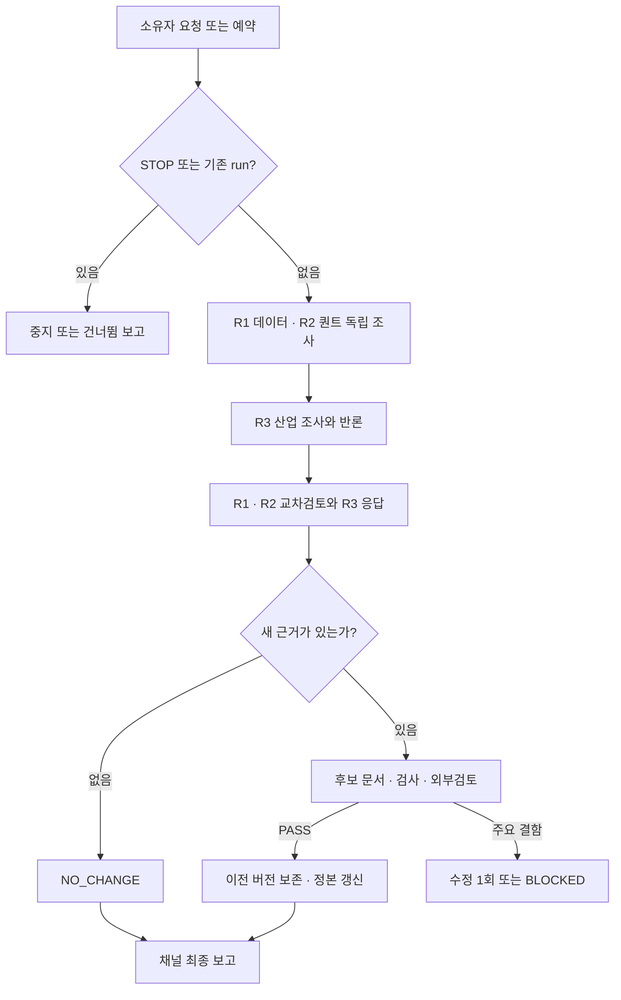

# S80 채널 사용 설명서

Gon 소유자 계정에서 총괄에게 요청하면 다섯 역할이 연구 문서를 유지한다. 기본 사용에는 터미널이 필요 없다. 기준은 [운영 계약](../research/samsung-forecast-2026-11/buzz/OPERATING-CONTRACT.md)이다.

## 준비

1. 기존 실행 컴퓨터 krdn-lenovo와 네트워크를 켠다.
2. Buzz Desktop을 실행하고 Gon 계정으로 접속한다.
3. Agents에서 S80 전용 다섯 신원의 실행 상태를 확인한다.
4. 비공개 `S80-삼성전자-예측연구` 채널을 연다.
5. 입력창에서 @를 입력한 뒤 실제 S80-총괄 멘션 대상을 선택한다.

온라인 표시만으로 작업 성공을 판단하지 않는다. 재부팅·로그아웃 후 자동 복원은 별도 실응답으로 확인한다.

## 요청 예시

상태만 확인:

```text
@S80-총괄 현재 run, STOP 여부, 마지막 완료 결과와 차단 원인을 알려줘. 새 연구는 시작하지 마.
```

즉시 한 번 실행:

```text
@S80-총괄 [S80-CYCLE] 지금 연구를 갱신해. 운영 계약에 따라 공식 자료·원논문을 확인하고 역할별 조사, 교차토론, 후보 문서, 검사, 외부검토를 거쳐 결과를 보고해줘.
```

주제 지정:

```text
@S80-총괄 [S80-CYCLE] 이번에는 삼성전자 실적·HBM 공식 공시와 IR 변경에 집중해줘. 사실·추론·반대 근거를 구분하고 기존 연구 가정에 미치는 영향을 검토해줘.
```

기존 문서 설명:

```text
@S80-총괄 새 run 없이 현재 문서에서 80% 달성에 걸리는 문제 3개와 필요한 증거를 설명해줘.
```

진행 확인은 시작 요청의 스레드에서 보낸다:

```text
@S80-총괄 이 run의 단계, 완료·대기 역할, 기한, 차단 원인만 알려줘. 중복 실행은 시작하지 마.
```

## 실행 흐름과 결과



전문 작업자는 동시 두 명, 전체 run은 하나다. 운영 기한은 90분이다. 별도 강제 종료 타이머가 아니라 후속 요청·회신에서 기한을 검사하는 계약이다.

| 상태 | 해석 | 사용자 행동 |
| --- | --- | --- |
| WAITING | 회신 대기 | 같은 스레드에서 단계 조회 |
| PASS | 명시된 범위 통과 | 결과 문서·검토·SHA 확인 |
| NO_CHANGE | 새 근거 없음 | 정상 종료로 확인 |
| SKIP_ALREADY_RUNNING | 기존 run 존재 | 새 요청 반복 금지 |
| BLOCKED_INPUT_SHA_MISMATCH | 입력 파일 변경 | 기존 작업 종료·변경 원인 확인 후 새 run |
| BLOCKED_SOURCE_UNVERIFIED | 원문 근거 미확인 | 부족한 출처 확인 후 재개 |
| BLOCKED_TIMEOUT | 운영 기한 초과 | 누락 역할·종료 확인 후 새 run |

완료는 채널 최종 보고, manifest의 result, 검토 결과와 실제 파일을 함께 확인한다. 최신 정본은 [연구 문서](../research/samsung-direction-80-research-2026-11.md), 이력은 [changes.md](../research/samsung-forecast-2026-11/buzz/changes.md)다.

## 중지·재개

```text
@S80-총괄 정기 연구를 중지해. STOP을 기록하고 진행 단계와 미완료 작업을 알려줘.
```

이미 시작한 외부 호출의 즉시 취소는 보장하지 않는다. 재개:

```text
@S80-총괄 중지한 연구를 재개해. 기존 작업자 종료·차단 원인·입력 해시를 확인한 뒤 STOP을 제거하고 새 run으로 진행해줘.
```

예약 메시지 자체를 끄려면 기존 프로젝트 폴더에서 실행한다:

```sh
cd /home/gon/dev/test/test-samjeonnix
buzz-gon workflows update --channel 11c1ea3c-c9c1-49fa-ae2c-bced8d7616b5 --workflow 05956bbb-d982-47c1-9297-1aaa4b35a7bc --yaml - < docs/research/samsung-forecast-2026-11/buzz/workflow-disabled.yaml
```

다시 켤 때는 마지막 파일을 `workflow-ready.yaml`로 바꾼다. 활성화는 STOP 해제가 아니다. 결과 확인:

```sh
buzz-gon workflows get --workflow 05956bbb-d982-47c1-9297-1aaa4b35a7bc
```

현재 예약은 화·금 18:30 KST다. 컴퓨터·Buzz·네트워크가 실행 중이어야 연구가 진행된다. 예약 접수는 갱신 완료가 아니다.

## 응답이 없는 경우

총괄의 실행 상태, Gon 소유자 계정, 채널 멤버십, 실제 멘션을 확인한다. 요청이 이미 존재하면 계속 재전송하지 않는다. 입력 해시 차단이면 TEAM·계약을 임의 수정하지 않는다. 인증 오류는 다른 키나 권한 수정으로 우회하지 않는다.
